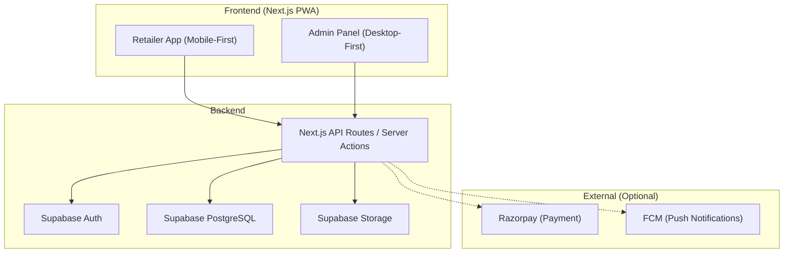

# 🏪 Store2Door — Master Build Plan

## Executive Summary
**Store2Door** is a B2B wholesale ordering PWA for local Kirana/retail shopkeepers to order wholesale stock from a single distributor (you), with delivery to their shop door.

> [!IMPORTANT]
> This is a PRODUCTION application, not a demo. Every feature must actually work.

## Architecture Overview

## Tech Stack
| Layer | Technology |
|-------|-----------|
| Framework | Next.js 15 (App Router) + TypeScript |
| Styling | Tailwind CSS v4 + shadcn/ui |
| Database | PostgreSQL via Supabase |
| Auth | Supabase Auth (email/password + magic link) |
| Storage | Supabase Storage |
| Forms | React Hook Form + Zod |
| Data Fetching | TanStack Query |
| Charts | Recharts |
| PWA | next-pwa / Serwist |
| Notifications | FCM Web Push (optional) |
| Payments | Razorpay (optional, COD default) |

## Database Schema (ERD)

### Core Tables
1. **profiles** — extends Supabase auth.users
2. **retailers** — shop info for retailers
3. **addresses** — delivery addresses
4. **categories** — product categories
5. **subcategories** — under categories
6. **brands** — product brands
7. **products** — main product entries
8. **product_variants** — SKU-level items with pricing/stock
9. **inventory_transactions** — audit trail for stock changes
10. **carts** / **cart_items** — shopping cart
11. **orders** / **order_items** — orders with price snapshots
12. **order_status_history** — status change log
13. **parcha_requests** — handwritten order slips
14. **payments** — payment records
15. **service_areas** — pincodes + localities
16. **banners** — promotional banners
17. **notifications** — push notification history
18. **business_settings** — app-wide config
19. **audit_logs** — admin action history

## Implementation Phases

### Phase 1: Foundation ✅
- Next.js project setup
- Tailwind + shadcn/ui
- Database migrations (all tables)
- RLS policies
- Type definitions
- Environment config

### Phase 2: Auth & Profiles
- Email/password registration
- Login/logout
- Profile creation (retailer info)
- Role management (SUPER_ADMIN, ADMIN, STAFF, RETAILER)
- Protected routes

### Phase 3: Customer Shell
- PWA manifest + service worker
- Bottom navigation
- Location setup (pincode → locality)
- Home page (banners, categories, featured products)
- Search

### Phase 4: Product Catalog
- Category browsing
- Product listing with variants
- Product detail page
- Variant selection UI
- MOQ enforcement

### Phase 5: Cart & Checkout
- Cart management (add/update/remove)
- Server-side price calculation
- Delivery/handling charge calculation
- COD checkout flow
- Order creation with stock reservation

### Phase 6: Parcha Workflow
- Camera/upload interface
- Slip submission with notes
- Admin review queue
- Convert to Order flow

### Phase 7: Admin — Core
- Dashboard with real stats
- Order management (list, detail, status updates)
- Product CRUD with variants
- Category/Brand management
- Inventory management

### Phase 8: Admin — Extended
- Business settings editor
- Service area management
- Banner management
- Push notification sending
- Retailer management

### Phase 9: Reports & Audit
- Daily sales report
- Revenue report
- Product performance report
- CSV export
- Audit logs

### Phase 10: Polish & Deploy
- PWA optimization
- Performance tuning
- Error handling
- Testing
- README + deployment docs

## Critical Business Rules
1. **Backend owns final price calculations** — never trust client totals
2. **Historical order prices never change** — snapshot at order time
3. **Stock changes require inventory_transaction** — audit trail
4. **Retailers never see cost/purchase price** — admin only
5. **Admin permissions server-verified** — no client-side checks
6. **Daily report = actual calendar day in Asia/Kolkata**
7. **Cancelled orders ≠ completed sales**
8. **Delivery, handling, discount = separate monetary fields**
9. **Parcha submission ≠ confirmed order**
10. **All settings admin-editable — no hardcoded values**

## Starting Now → Phase 1
